<div align="center">

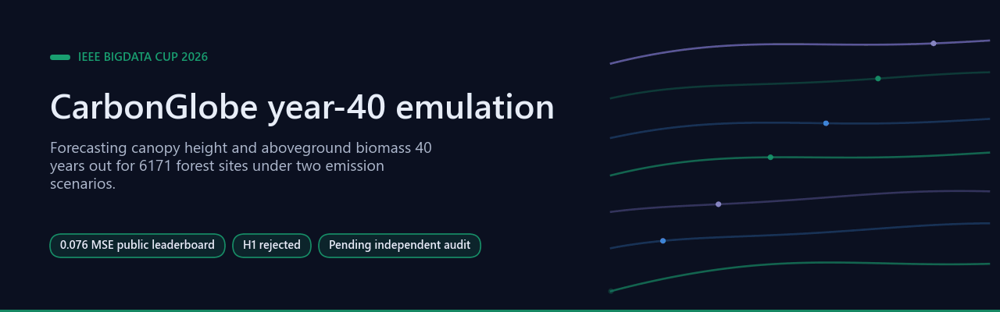

# CarbonGlobe year-40 emulation — IEEE BigData Cup 2026

[](https://github.com/Agnuxo1/carbonglobe-emulator-2026/actions/workflows/ci.yml) [](LICENSE)  [](https://www.kaggle.com/competitions/ieee-bigdata-cup-2026-ai-emulation-challenge) [](experiments/ABLACION_H1.md)  [](ATTRIBUTION.md)

[**How it works**](#how-it-works) · [**Results**](#results) · [**Observations**](#observations-and-limitations) · [**Technical report**](TECHNICAL_REPORT.md) · [**H1 ablation**](experiments/ABLACION_H1.md) · [**Bibliography**](#bibliography)

</div>

**Public leaderboard score 0.076 MSE — about rank 71 of 218 teams, against a field median
of 0.092.** Emulating a process-based global land-ecosystem model (Ecosystem Demography,
ED) to forecast, for 6171 forest sites and 15 seed forest ages under two future emission
scenarios, the canopy height and aboveground biomass 40 years out.

Entry for the [IEEE BigData Cup 2026 AI Emulation Challenge](https://www.kaggle.com/competitions/ieee-bigdata-cup-2026-ai-emulation-challenge),
built on the CarbonGlobe benchmark (Wang et al., NeurIPS 2025). Metric: MSE on each
variable divided by its global mean. Author: Francisco Angulo de Lafuente
([@Agnuxo1](https://github.com/Agnuxo1)). Licence: MIT. No competition data is
redistributed here — see [ATTRIBUTION.md](ATTRIBUTION.md).
See [TECHNICAL_REPORT.md](TECHNICAL_REPORT.md) for the full write-up.

| | MSE | approx. rank |
|---|---|---|
| **this entry** (anchor + neural emulator, w = 0.3) | **0.076** | **~71 / 218** |
| field median | 0.092 | 109 |
| competition leader | 0.037 | 1 |
| persistence (`y₄₀ = y₀`) | 0.285 | 211 |
| per-age constant | 1.542 | 217 |

Competition open until 2026-11-16 05:00 UTC.

---

**Contents** — [How it works](#how-it-works) · [Background](#background) · [Results](#results) · [Reproducing](#reproducing) · [Observations and limitations](#observations-and-limitations) · [Real-world applications](#real-world-applications) · [Possible improvements](#possible-improvements) · [Future work](#future-work) · [Bibliography](#bibliography)

<p align="center">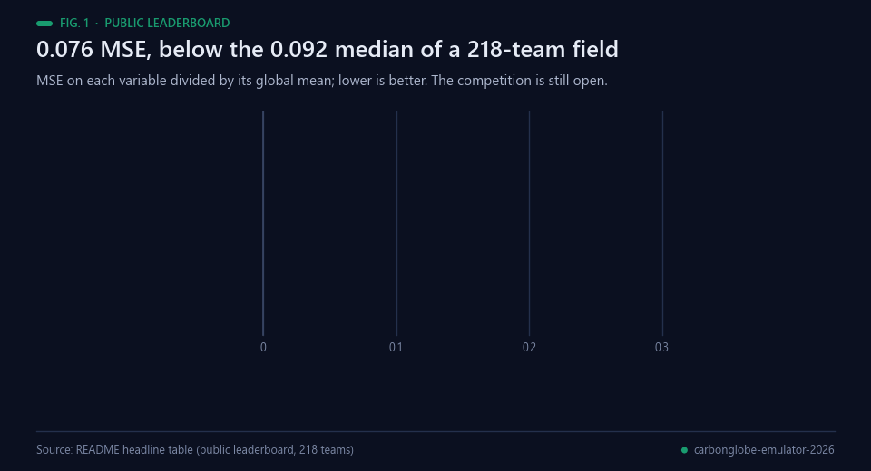<br><sub>Fig. 1 — Public leaderboard, lower is better. The competition is open and the private split is unscored. Data: the table above.</sub></p>

## How it works

Three ingredients, listed by how much each contributes.

<p align="center">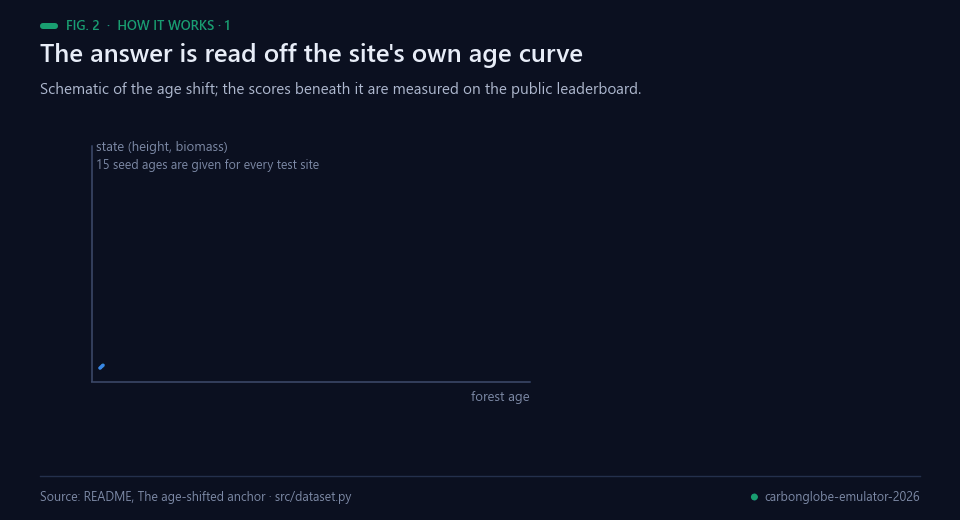<br><sub>Fig. 2 — Schematic of the age shift; the scores are measured. Data: README and src/dataset.py.</sub></p>

### 1. The age-shifted anchor — the backbone, and it is free

The competition hands you, for every test site, the initial ecosystem state at **all 15
seed ages**: the site's own state-versus-forest-age curve. A stand that begins at seed age
*a* and grows for 40 years finishes at forest age *a + 40*. So the answer can be **read off
that curve**, with no model and no fitted parameter:

```python
anchor = interp_over_log_age(y0_curve, at=age + 40)      # src/dataset.py
```

**0.094 on the leaderboard, zero training**, which on its own already matches the median of
a 218-team field. It is the single largest contribution in this entry, and it is the
reason the final system is a *correction to* the anchor rather than a replacement for it.

Five interpolators were compared (`src/anchor_variants.py`) and they land between 0.173
and 0.186 on present-day data, so interpolation accuracy is not the binding constraint:
the anchor's residual is the genuine effect of 40 years of altered climate.

<p align="center">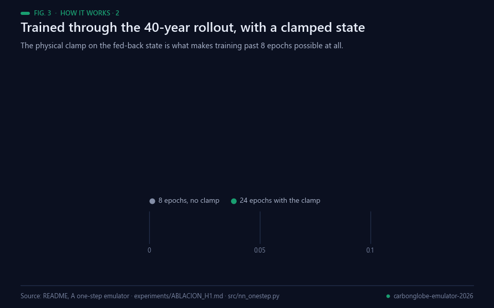<br><sub>Fig. 3 — The rollout and the clamp. Data: README and experiments/ABLACION_H1.md.</sub></p>

### 2. A one-step emulator trained through the rollout — the correction

Per site, seed age and year, the model maps [annual-mean forcing of that year (136 drivers)
; December state of the previous year (7) ; seed age / 500] to the next December state, and
is rolled out 40 years from y₀ alone. Two choices matter:

* **Residual parameterisation**: the network predicts the annual increment, not the state.
* **Trained on the rollout, not one step ahead.** Teacher forcing is annealed to zero and
  gradients are backpropagated through the whole 40-step unroll, with the loss weighted
  towards the scored final year. The organizers' tutorial warns that long-horizon drift is
  what separates emulators; this optimises against it directly.

Local held-out rollout MSE at year 40: **0.0451**. On the leaderboard, alone, 0.166.

* **A physical clamp on the fed-back state** (`state_bounds`) is what makes it trainable at
  all beyond 8 epochs. Without it, training diverged to NaN reproducibly, at exactly the
  epoch where teacher forcing reaches zero while the one-cycle learning rate is still near
  its peak: the fed-back state leaves the range the one-step map has ever seen and forty
  compositions of an unconstrained increment blow up. Clamping fixes that and improves the
  model on its own, 0.0515 → **0.0451** at the same seed, warm-site subset 0.0860 → 0.0709.

<p align="center">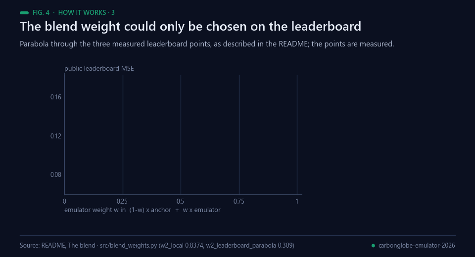<br><sub>Fig. 4 — The blend weight. Data: README and src/blend_weights.py.</sub></p>

### 3. The blend — 19 % off the anchor's score

`0.7 × anchor + 0.3 × emulator` scores **0.076**, better than either part (0.094 and
0.166). The two error structures are complementary enough that the mixture wins. A parabola
through the three measured leaderboard points puts the optimum at w = 0.309, so the
submitted weight is already essentially optimal and re-tuning it buys nothing.

## Background

<p align="center">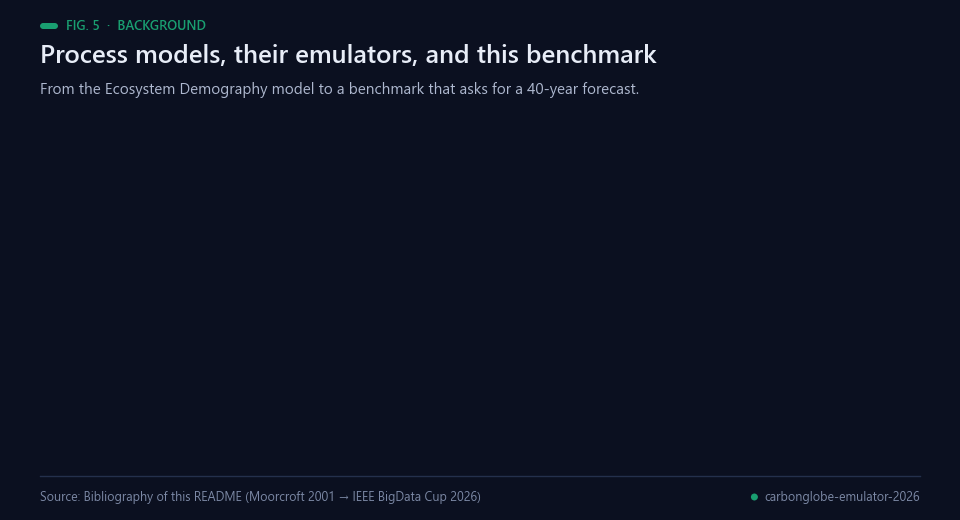<br><sub>Fig. 5 — Milestones behind this work. Sources: bibliography below.</sub></p>

The quantity being emulated comes from a process model. The Ecosystem Demography model was introduced as a
method for scaling vegetation dynamics [[3](#ref-3)], and its second version was developed as a constrained
implementation of a structured terrestrial biosphere model, tested against field measurements of vegetation
dynamics and carbon fluxes [[4](#ref-4)]. Running such a model across many emission pathways is expensive, which
is the standing reason for emulators: MESMER, for instance, was built because generating large single-model
and multi-model climate ensembles is computationally costly [[7](#ref-7)]. The pathways themselves are the Shared
Socioeconomic Pathways [[5](#ref-5)] as organised for CMIP6 by ScenarioMIP [[6](#ref-6)]. CarbonGlobe assembled a
global, multi-decade benchmark for carbon forecasting in forest ecosystems from this material [[2](#ref-2)], and
the IEEE BigData Cup 2026 asks entrants for the state 40 years out, at 6171 sites, under two of those
scenarios [[1](#ref-1)].

On the modelling side, the choice here is a one-step map rolled forward rather than a direct 40-year
regression. Training a sequence model on its own predictions instead of on ground truth is the gap scheduled
sampling was proposed to close [[12](#ref-12)], and it is what the annealed teacher forcing in `src/nn_onestep.py`
does. The alternative recurrent family tested here is reservoir computing: echo state networks train only a
linear readout over a fixed random recurrent state [[8](#ref-8)], a line surveyed in [[9](#ref-9)]. The author's own
`holographic-reservoir` library belongs to that family, adding SHA-256-derived diagonal entropy to the
recurrent matrix [[10](#ref-10)], and `pixelflow`, the same author's GPU texture reservoir, was the planned spatial
component [[11](#ref-11)]. LightGBM [[17](#ref-17)] stands in for the direct-regression baseline.

The evaluation side is where this entry's second result sits. Held-out sites are taken in contiguous 10 degree
blocks because cross-validation that ignores structure in the data underestimates predictive error
[[15](#ref-15)]; the delta-change construction that was tried and discarded is a standard device in
climate-impact work [[13](#ref-13)]; and selecting among candidates against a public leaderboard is adaptive data
analysis, whose cost to the validity of the result is itself a measured subject [[14](#ref-14)].

## Results

<p align="center">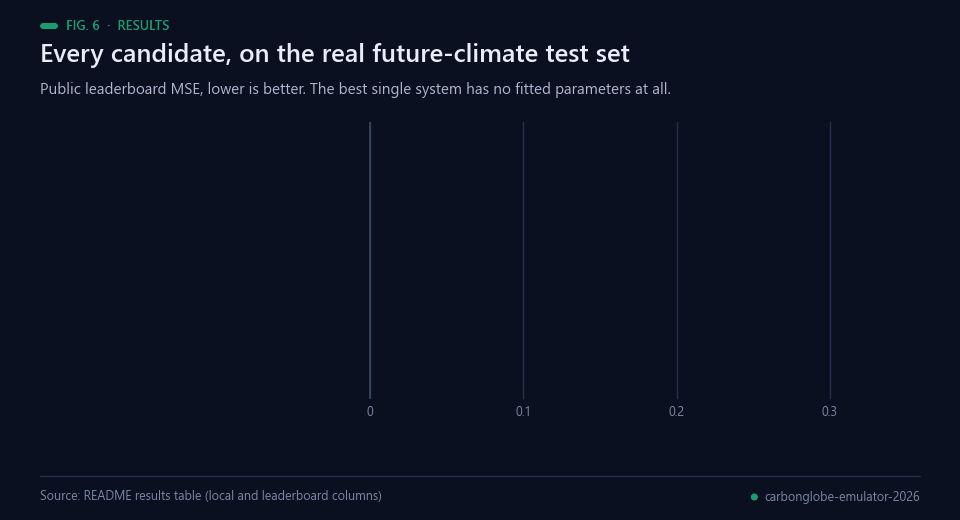<br><sub>Fig. 6 — Every candidate on the real future-climate test set. Data: the table below.</sub></p>

`local` is held-out validation on the present-day training distribution, by contiguous 10°
lon/lat blocks; `leaderboard` is the competition's public score on the real future-climate
test set.

| system | local | leaderboard | rank |
|---|---|---|---|
| **anchor + neural emulator, w = 0.3** | 0.0801 | **0.076** | **~71** |
| age-shifted anchor, nothing fitted | 0.1799 | 0.094 | ~115 |
| anchor + mean of the two emulators, w = 0.3 | — | 0.082 | ~78 |
| anchor + climate delta (delta-change construction) | — | 0.109 | ~130 |
| anchor + per-age affine recalibration (60 params) | 0.1342 | 0.137 | ~144 |
| neural one-step emulator alone, 40-year rollout | 0.0451 | 0.166 | ~164 |
| Holographic-Reservoir one-step emulator, 40-year rollout | 0.1808 | 0.245 | ~198 |
| LightGBM direct 40-year regression | 0.0425 | 0.257 | ~205 |
| persistence, y₄₀ = y₀ | 0.2962 | 0.285 | ~211 |
| per-age constant | 1.6455 | 1.542 | ~217 |

<p align="center">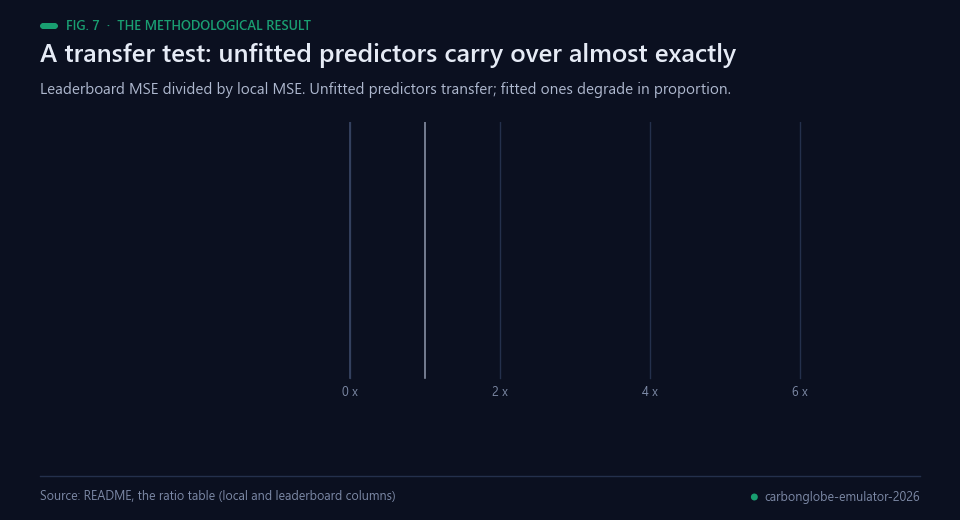<br><sub>Fig. 7 — Local validation does not rank models here. Data: the ratio table below.</sub></p>

### The methodological result: this benchmark's held-out validation does not rank models

This is the finding most likely to be useful to anyone else entering the competition, and
it is measured, not argued. Local present-day validation and the leaderboard disagree by a
factor that depends on how hard the system was fitted:

| system | local | leaderboard | ratio |
|---|---|---|---|
| per-age constant | 1.6455 | 1.542 | 0.94 |
| persistence | 0.2962 | 0.285 | 0.96 |
| age-shifted anchor | 0.1799 | 0.094 | **0.52** |
| reservoir emulator (rollout) | 0.1808 | 0.245 | 1.35 |
| neural emulator (rollout) | 0.0451 | 0.166 | 3.68 |
| LightGBM direct regression | 0.0425 | 0.257 | **6.05** |

Unfitted predictors transfer almost exactly, which rules out a format, id-alignment or
scaling error and confirms the test target variance matches the present-day variance. What
degrades is anything fitted against present-day validation, in proportion to how hard it
was fitted. Two consequences we measured rather than guessed:

* **Rollout beats the direct jump by 4× in transfer.** A one-step map learns local physics
  that does not depend on which scenario produced the forcing (1.35×–3.68×); a direct
  40-year regression learns a climate-specific shortcut (6.05×).
* **Not even blend weights can be chosen locally.** Present-day data puts the optimal
  anchor/emulator weight at w = 0.837, almost the pure emulator; the leaderboard puts it at
  0.309. Had we trusted the local fit we would have submitted something near 0.166 instead
  of 0.076 (`src/blend_weights.py`).

<p align="center">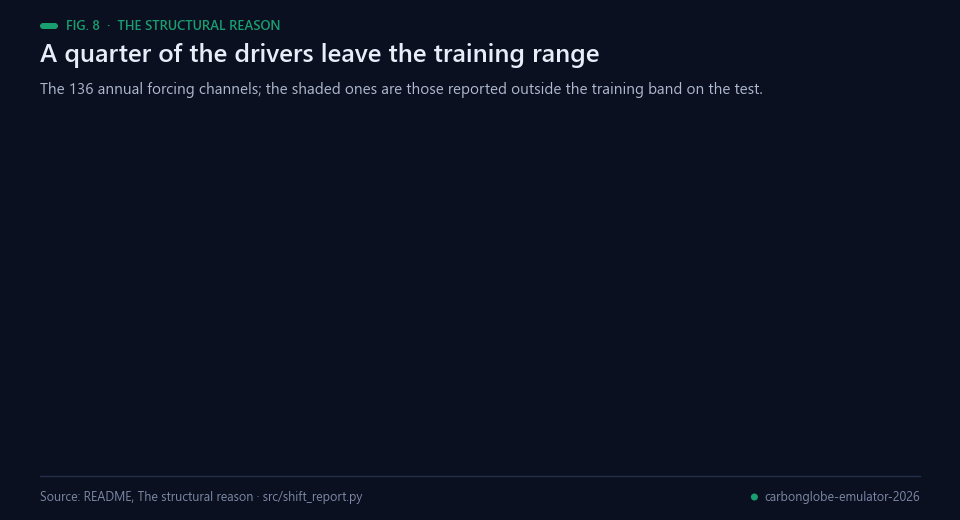<br><sub>Fig. 8 — Why: a quarter of the drivers leave the training range. Data: src/shift_report.py.</sub></p>

The structural reason is visible in the data. **25 of the 136 drivers lie almost entirely
outside the training range on the test** (indices 8–31, plus static channel 135: more than
90 % of test rows outside the training 1–99 percentile band, with trends up to 8.8
training-spans outside) — and those are precisely the channels that separate SSP126 from
SSP585. Meanwhile the training set holds **exactly one forcing record per site**, so it
contains no scenario variation at all from which their effect could be learned. We feed
them as within-record anomalies instead (`src/shift_report.py`).

## Reproducing

<p align="center">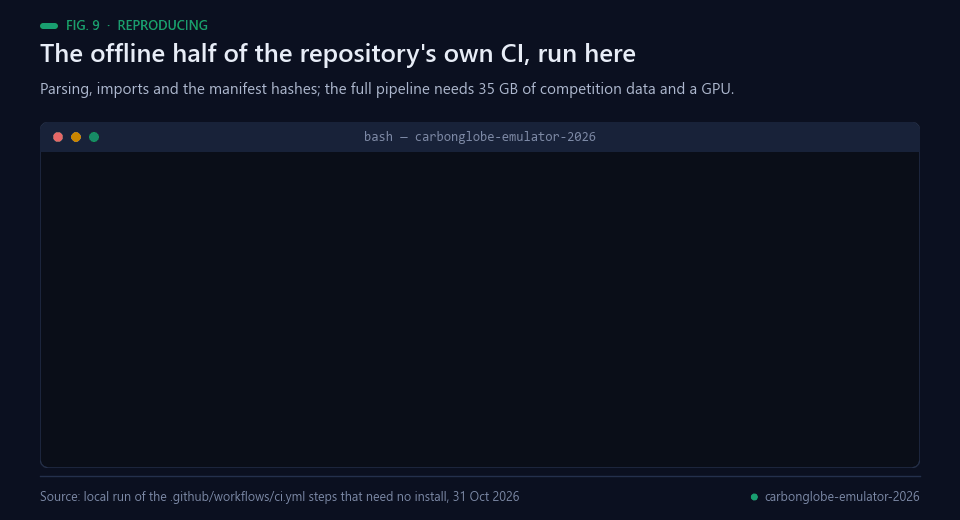<br><sub>Fig. 9 — A real local run of the CI steps that need no install, 31 Oct 2026.</sub></p>

```bash
pip install -r requirements.txt
pip install holographic-reservoir          # the author's reservoir library, tested below
DATA=/some/disk/with/35GB bash reproduce.sh
```

`reproduce.sh` downloads both datasets with the official Kaggle API (you need a token and
to have accepted the competition rules), builds the derived arrays, reruns the ablation and
writes every submission candidate. A GPU is needed for the emulators; the anchor and the
probes are pure NumPy. `tests/test_hrc_port.py` checks that the batched GPU reservoir
reproduces the library's own `_collect_states` to 8 × 10⁻⁸.

Hardware used: one RTX 3090, 24 GB host RAM. Every array is memory-mapped and streamed in
chunks, so peak RAM stays under about 2 GB. Every number in this README comes from a run
recorded in `experiments/`.

---

## Observations and limitations

Everything here is a real measurement and none of it is softened; it is at the end because
it is the limiting detail, not the result.

<p align="center">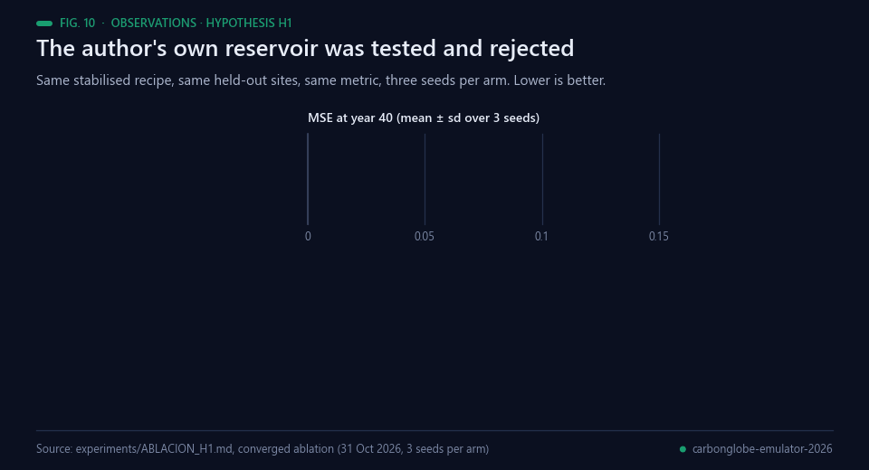<br><sub>Fig. 10 — The converged H1 ablation, three seeds per arm. Data: experiments/ABLACION_H1.md.</sub></p>

**Hypothesis H1 — the Holographic-Reservoir — was rejected.**
[`holographic-reservoir`](https://pypi.org/project/holographic-reservoir/) is this author's
own library: a leaky echo-state reservoir with a sparse recurrent matrix rescaled to a
target spectral radius, SHA-256-derived diagonal entropy, and a trained linear readout. It
was tested in the role that fits the task best — the recurrent core of the one-step
emulator — against the neural control, on the same held-out sites, the same metric and a
matched budget, three seeds per arm:

| arm | MSE year 40 (mean ± sd, 3 seeds) | warm sites | min/seed |
|---|---|---|---|
| Holographic-Reservoir + ridge readout (N = 801, 3 leak rates, quadratic readout) | 0.1528 ± 0.0031 | 0.2384 | 5.3 |
| **neural control** (residual MLP on the rollout) | **0.0489 ± 0.0026** | 0.0710 | 7.1 |
| hybrid (control + reservoir state as 300 extra inputs) | 0.0497 ± 0.0037 | 0.0852 | 9.0 |

All three arms now run the identical stabilised recipe (state clamp, 24 epochs, teacher
forcing annealed to mid-training) at three seeds each, so this replaces the earlier
8-epoch table, which was reported with a non-convergence caveat. It moves in both
directions and both are stated:

* **The rejection of H1 is stronger.** The reservoir alone goes from 2.58× to **3.13×** the
  control's MSE, and the control's spread tightens from ±0.0091 to ±0.0026. The intervals
  are now separated by a wide margin.
* **The hybrid improves, and that must be said.** It goes from 1.24× to **1.02×**: a
  difference of 0.0008 against standard deviations of 0.0026 and 0.0037. The correct claim is
  no longer that it is worse, but that **the reservoir state as an extra input is
  indistinguishable from the control on the metric, and costs 27 % more time** (9.0 against
  7.1 minutes per seed). There is still no reason to use it, but the reason is cost, not
  accuracy. This is a result in the own technology's favour relative to what was published
  before, and it is recorded here with the same prominence.

An independent three-way least-squares fit on held-out sites assigns the reservoir a weight
of 0.016 against 0.806 for the neural emulator, pointing the same way as the table above.

What the reservoir does deliver is training cost: only the readout is fitted, in closed form
from all 32 491 200 teacher-forced samples in about 50 s. That is real, and it is not enough
to make it competitive here. Within its own family a quadratic readout helped (0.1808 →
0.1638 at N = 400) and width helped (0.1560 at N = 801); multiple leak rates alone did not.

<p align="center">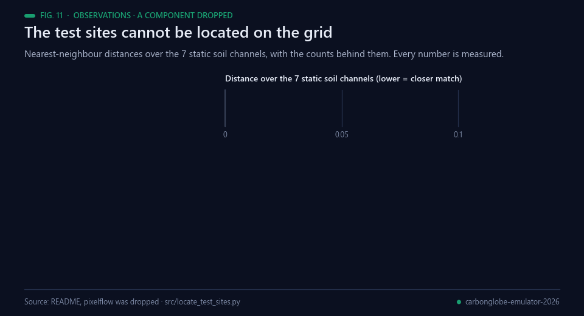<br><sub>Fig. 11 — Why no spatial model was built. Data: src/locate_test_sites.py.</sub></p>

**`pixelflow` was dropped, with a measured reason.** It was the planned spatial-coupling
component, but the 6171 test sites cannot be located on the 0.5° grid: matching on the 7
static soil channels gives a nearest-neighbour distance of 0.091 against 0.104 for the
second nearest, with not one exact match across 6171 sites — the generic nearest-neighbour
spacing for 54 152 points in 7 dimensions, i.e. no identification — and static channel 135
is itself out of the training range (`src/locate_test_sites.py`). Without coordinates there
is no neighbourhood to couple, so no spatial model was built and none is claimed.

<p align="center">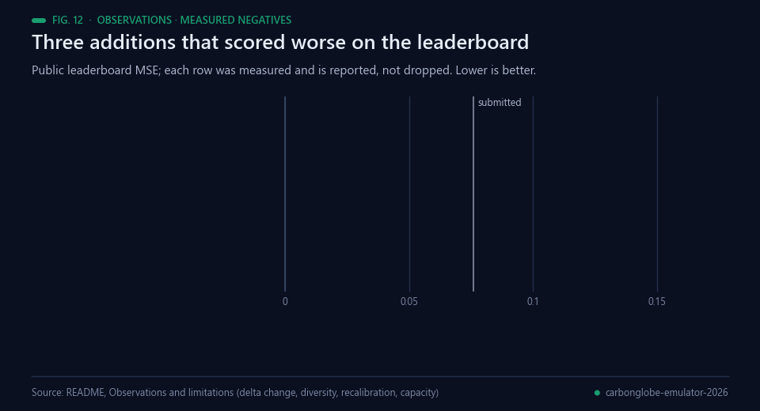<br><sub>Fig. 12 — Measured negatives, each kept rather than dropped. Data: the sections beside it.</sub></p>

**The delta-change construction did not work.** Rolling the emulator out under the SSP
forcing and again under a stationary-climate counterfactual (the 25 shifted drivers'
anomalies zeroed), then adding the difference to the anchor, scores **0.109** — worse than
the anchor alone. The learned delta does carry the right scenario ordering (mean +0.0202
under SSP585 against +0.0110 under SSP126, per-site sd 0.124) and the idea is standard in
climate-impact work, but on this task the emulator's climate response is not accurate
enough for the difference to pay for itself.

**Emulator diversity does not help the blend.** Replacing the emulator side with the mean
of the neural and reservoir emulators, at the same total share of 0.3, scores **0.082**
against 0.076 for the neural emulator alone: the reservoir drags the mixture down even at a
15 % effective weight. Their predictions correlate at 0.915, so the diversity is real; it
simply is not useful diversity.

**More capacity does not help.** A wider, longer-trained emulator (768x4, 36 epochs) collapses
when teacher forcing is fully removed -- rollout loss 0.0165 at epoch 12 rising to 0.1301 at
epoch 18 -- and plateaus at 0.128, far above the 0.0451 the 512x3 model reaches. The run also hit
host-memory exhaustion at epoch 27 with 0.69 GB free. The 512x3 recipe is kept; the emulator is
still short of its ceiling in *epochs* but appears to be at it in *width* for this rollout
objective.

**Fitting the anchor on present-day data hurts it**, even minimally: a 60-parameter per-age
affine recalibration takes it from 0.094 to **0.137**.

<p align="center">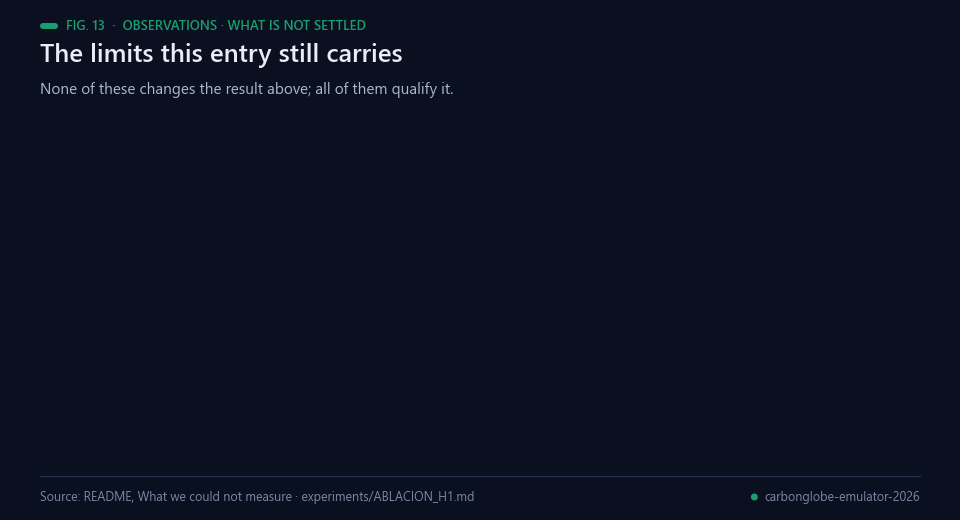<br><sub>Fig. 13 — What is not settled. Data: README and experiments/ABLACION_H1.md.</sub></p>

**What we could not measure.** No local validation here predicts the leaderboard, so model
selection is done against the leaderboard itself with a small number of deliberately
distinct candidates — which means the final choice carries public-leaderboard selection
risk against the private split. The emulator is not at its ceiling: with the stabilised
recipe the training loss was still falling at 24 epochs. And **this work has not been
independently audited**: the external audit channel the house protocol requires was
unavailable (`codex exec` fails at account level), so the project stands as *pending
independent audit*, not approved.

**What the comparison in §Results is worth remembering for.** The best *single* system in
this repository has no fitted parameters at all, and every trained model here — the
author's own technology included — scored worse than it on the real test set. The entry
wins only by combining the unfitted anchor with a trained emulator at a weight the
leaderboard, not the validation set, had to choose.

## Real-world applications

<p align="center">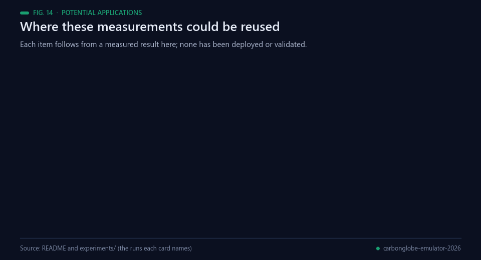<br><sub>Fig. 14 — Potential reuse. Nothing here has been deployed or validated.</sub></p>

Forest canopy height and aboveground biomass are measured at global scale by missions such as GEDI
[[16](#ref-16)], and emulators exist so that process-model projections can be produced for pathways no one can
afford to simulate directly [[7](#ref-7)]. None of the following has been built or validated; each is a use the
measurements here would support.

- **A free first baseline wherever an age curve exists.** If a process model already supplies the state at
  several stand ages, the 40-year answer can be read off that curve with no fitted parameter. Here that alone
  scored 0.094, about the median of a 218-team field.
- **A transfer check before trusting a validation score.** The ratio between leaderboard and local error ran
  from 0.94 for an unfitted predictor to 6.05 for a directly fitted regression. Computing that ratio for a few
  deliberately unfitted predictors is a cheap test of whether a local split can rank models at all.
- **Rollout training in preference to a direct jump.** The one-step map transferred roughly four times better
  than the direct 40-year regression, which may hold for other long-horizon emulators of the same shape
  [[12](#ref-12)].
- **Clamping the fed-back state.** Bounding the state to a physically reachable range turned a reproducible
  divergence to NaN into three times the training, and improved the model on its own (0.0515 to 0.0451).
- **Out-of-range driver reports before fitting.** The percentile report names which forcing channels the test
  set moves outside the training band — here 25 of 136 — which is information available before any model is
  trained [[5](#ref-5), [6](#ref-6)].
- **Published negatives.** The discarded constructions carry their scores, so other entrants in this
  competition [[1](#ref-1)] can skip them rather than measure them again.

## Possible improvements

<p align="center">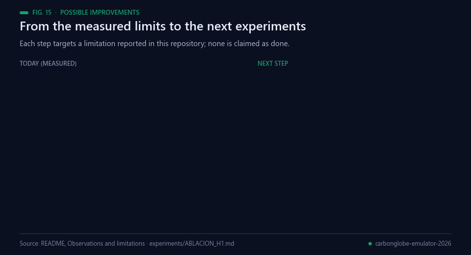<br><sub>Fig. 15 — Each improvement targets a limitation reported in this repository.</sub></p>

- **A validation split that can rank models.** Nothing local here predicts the leaderboard, so selection runs
  against the public leaderboard and carries the corresponding risk against the private split [[14](#ref-14)]. A
  split built from scenario-shifted rows, rather than present-day blocks [[15](#ref-15)], is the first thing worth
  building.
- **Train the emulator to its ceiling in epochs.** With the stabilised recipe the training loss was still
  falling at 24 epochs, and the state clamp is what now makes longer training possible. The blend weight
  should be re-measured afterwards, because the 0.309 optimum was fitted to the current emulator.
- **Give the shifted channels something learnable.** 25 of the 136 drivers lie almost entirely outside the
  training range, and the training set holds exactly one forcing record per site, so no scenario variation
  exists from which their effect could be learned. A source with per-site scenario variation would change
  that; feeding them as within-record anomalies is a workaround, not a solution.
- **Close the audit.** The external audit channel the house protocol requires was unavailable, so the work
  stands as pending independent audit. Running it elsewhere, and recording whatever it changes next to the
  measurement it changes, is outstanding.
- **Revisit the reservoir only where its cost advantage pays.** Fitting the readout in closed form in about
  50 s from 32 491 200 samples is real; the measured accuracy gap (3.13x) is not closed by it on this task
  [[8](#ref-8), [9](#ref-9)].

## Future work

<p align="center">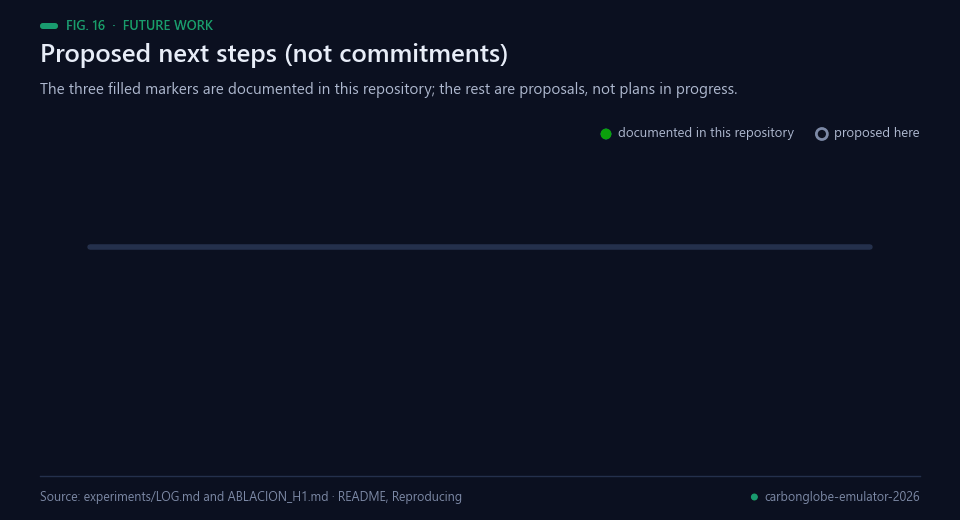<br><sub>Fig. 16 — The three filled markers are documented in this repository; the rest are proposals.</sub></p>

Proposed next steps, not commitments. Only the first three are documented in this repository as done; the
others are proposals and none is claimed as started:

1. *Documented.* The anchor and the blend were submitted and scored on the public split, at 0.094 and 0.076.
2. *Documented.* Rollout training was stabilised with the state clamp, which took the emulator from 0.0515 to
   0.0451 and allowed 24 epochs instead of 8.
3. *Documented.* The H1 ablation was rerun to convergence on 31 October 2026 with three seeds per arm, and
   both directions of what it changed are recorded in `experiments/ABLACION_H1.md`.
4. Train the 512x3 emulator until the loss stops falling, then re-measure the blend weight.
5. Build a validation split that can rank models under scenario shift, and check it against the ratios
   already measured.
6. Put the work through an independent audit on a channel that is available.
7. Record the private-split result when the competition closes [[1](#ref-1)], whatever it says.

## Bibliography

1. <a id="ref-1"></a>IEEE BigData Cup 2026 organizers (2026). *AI Emulation Challenge* (Kaggle competition). https://www.kaggle.com/competitions/ieee-bigdata-cup-2026-ai-emulation-challenge
2. <a id="ref-2"></a>Wang, Z., Ma, L., Hurtt, G., Jia, X., Li, Y., Li, R., Li, Z., Xu, S., & Xie, Y. (2025). CarbonGlobe: a global-scale, multi-decade dataset and benchmark for carbon forecasting in forest ecosystems. *Advances in Neural Information Processing Systems (NeurIPS)*, 38. Benchmark code: https://github.com/zhwang0/carbon-globe
3. <a id="ref-3"></a>Moorcroft, P. R., Hurtt, G. C., & Pacala, S. W. (2001). A METHOD FOR SCALING VEGETATION DYNAMICS: THE ECOSYSTEM DEMOGRAPHY MODEL (ED). *Ecological Monographs*, 71(4), 557–586. https://doi.org/10.1890/0012-9615(2001)071[0557:AMFSVD]2.0.CO;2
4. <a id="ref-4"></a>Medvigy, D., Wofsy, S. C., Munger, J. W., Hollinger, D. Y., & Moorcroft, P. R. (2009). Mechanistic scaling of ecosystem function and dynamics in space and time: Ecosystem Demography model version 2. *Journal of Geophysical Research: Biogeosciences*, 114(G1). https://doi.org/10.1029/2008JG000812
5. <a id="ref-5"></a>Riahi, K., van Vuuren, D. P., Kriegler, E., et al. (2017). The Shared Socioeconomic Pathways and their energy, land use, and greenhouse gas emissions implications: An overview. *Global Environmental Change*, 42, 153–168. https://doi.org/10.1016/j.gloenvcha.2016.05.009
6. <a id="ref-6"></a>O'Neill, B. C., Tebaldi, C., van Vuuren, D. P., et al. (2016). The Scenario Model Intercomparison Project (ScenarioMIP) for CMIP6. *Geoscientific Model Development*, 9(9), 3461–3482. https://doi.org/10.5194/gmd-9-3461-2016
7. <a id="ref-7"></a>Beusch, L., Gudmundsson, L., & Seneviratne, S. I. (2020). Emulating Earth system model temperatures with MESMER: from global mean temperature trajectories to grid-point-level realizations on land. *Earth System Dynamics*, 11(1), 139–159. https://doi.org/10.5194/esd-11-139-2020
8. <a id="ref-8"></a>Jaeger, H., & Haas, H. (2004). Harnessing Nonlinearity: Predicting Chaotic Systems and Saving Energy in Wireless Communication. *Science*, 304(5667), 78–80. https://doi.org/10.1126/science.1091277
9. <a id="ref-9"></a>Lukoševičius, M., & Jaeger, H. (2009). Reservoir computing approaches to recurrent neural network training. *Computer Science Review*, 3(3), 127–149. https://doi.org/10.1016/j.cosrev.2009.03.005
10. <a id="ref-10"></a>Angulo de Lafuente, F. (2026). *holographic-reservoir* (Python package, Apache-2.0). https://pypi.org/project/holographic-reservoir/
11. <a id="ref-11"></a>Angulo de Lafuente, F. (2026). *pixelflow* (source code, Apache-2.0). https://github.com/Agnuxo1/pixelflow
12. <a id="ref-12"></a>Bengio, S., Vinyals, O., Jaitly, N., & Shazeer, N. (2015). Scheduled Sampling for Sequence Prediction with Recurrent Neural Networks. *arXiv* 1506.03099. https://arxiv.org/abs/1506.03099
13. <a id="ref-13"></a>Teutschbein, C., & Seibert, J. (2012). Bias correction of regional climate model simulations for hydrological climate-change impact studies: Review and evaluation of different methods. *Journal of Hydrology*, 456-457, 12–29. https://doi.org/10.1016/j.jhydrol.2012.05.052
14. <a id="ref-14"></a>Dwork, C., Feldman, V., Hardt, M., et al. (2015). The reusable holdout: Preserving validity in adaptive data analysis. *Science*, 349(6248), 636–638. https://doi.org/10.1126/science.aaa9375
15. <a id="ref-15"></a>Roberts, D. R., Bahn, V., Ciuti, S., et al. (2017). Cross‐validation strategies for data with temporal, spatial, hierarchical, or phylogenetic structure. *Ecography*, 40(8), 913–929. https://doi.org/10.1111/ecog.02881
16. <a id="ref-16"></a>Dubayah, R., Blair, J. B., Goetz, S., et al. (2020). The Global Ecosystem Dynamics Investigation: High-resolution laser ranging of the Earth’s forests and topography. *Science of Remote Sensing*, 1, 100002. https://doi.org/10.1016/j.srs.2020.100002
17. <a id="ref-17"></a>Ke, G., Meng, Q., Finley, T., Wang, T., Chen, W., Ma, W., Ye, Q., & Liu, T.-Y. (2017). LightGBM: a highly efficient gradient boosting decision tree. *Advances in Neural Information Processing Systems*, 30, 3146–3154. https://papers.nips.cc/paper_files/paper/2017/hash/6449f44a102fde848669bdd9eb6b76fa-Abstract.html

---

<div align="center">
<sub>Built by <a href="https://github.com/Agnuxo1">Francisco Angulo de Lafuente</a> · every figure is an animated
rendering of the published file named in its footer · <a href="#carbonglobe-year-40-emulation--ieee-bigdata-cup-2026">back to top ↑</a></sub>
</div>
